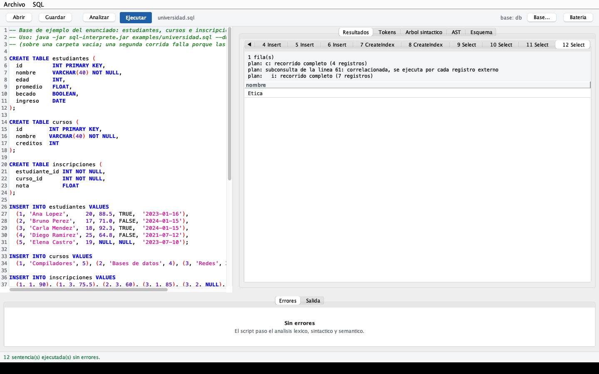
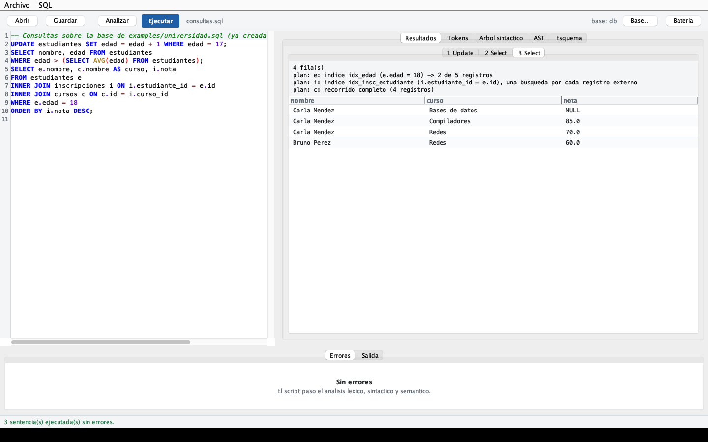
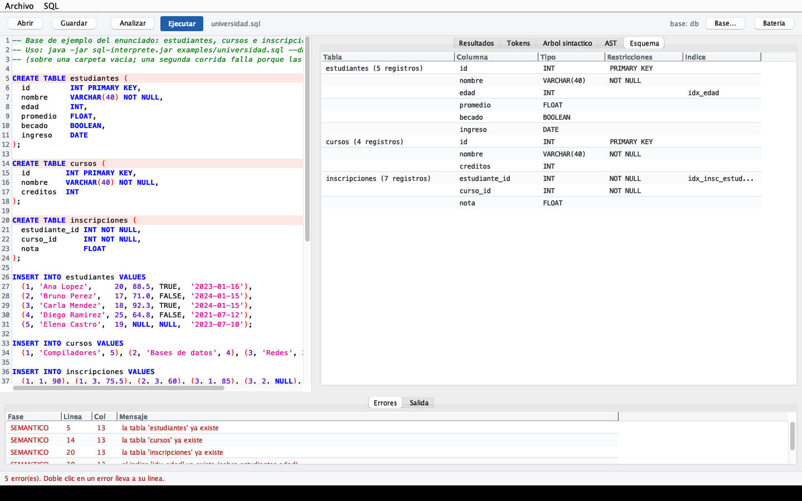
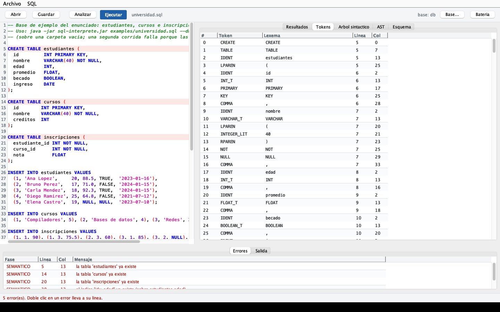
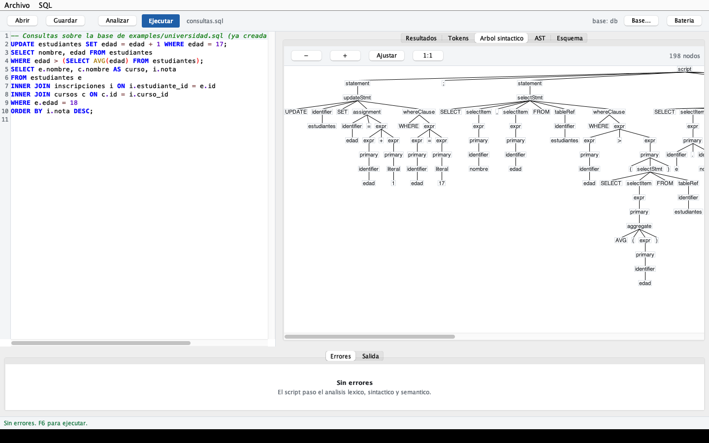
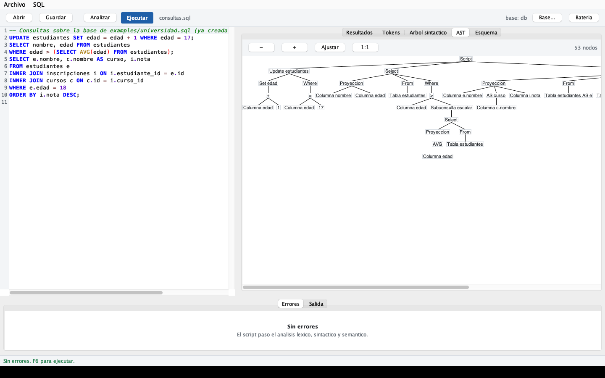
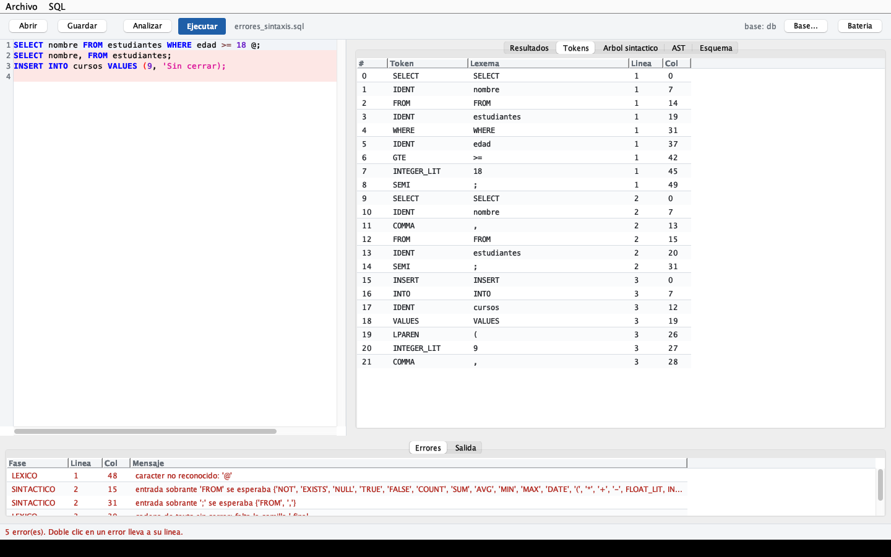
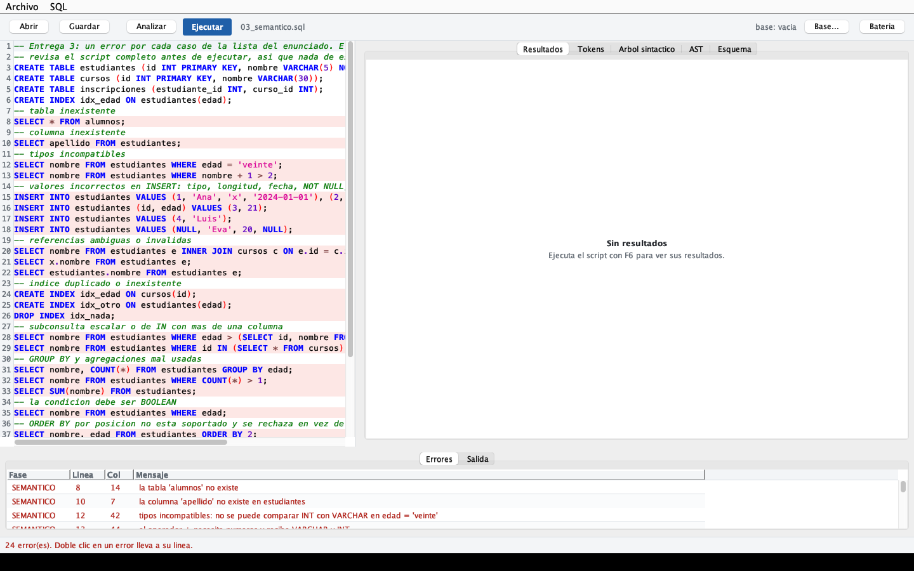
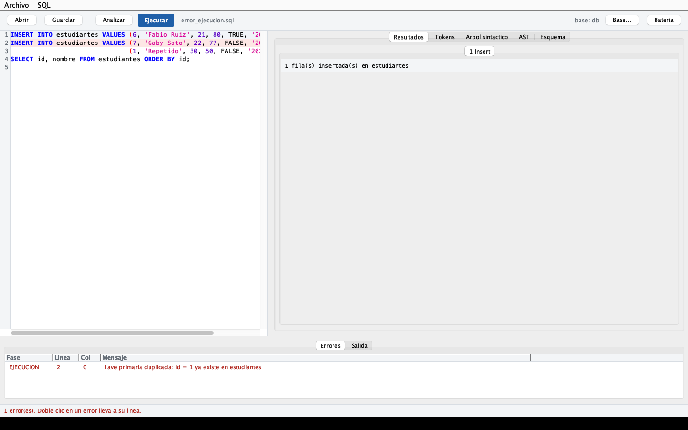

# Intérprete SQL con almacenamiento en archivos

Proyecto de Construcción de Compiladores (UVG). Intérprete de un subconjunto de
SQL construido con ANTLR 4 y Java 17. No usa ningún DBMS: las bases de datos
son carpetas con archivos de texto, y el esquema, los registros y los índices se
leen y escriben con código propio.

```
SQL -> léxico -> sintáctico -> AST -> semántico -> interpretación -> archivos -> resultado
```

## Requisitos

- Docker (recomendado), **o** JDK 17 o superior.
- Maven no hace falta: el wrapper `./mvnw` lo descarga.

## Compilar y probar (Docker, reproducible)

```bash
docker compose up -d --build                                 # una vez
docker compose exec sql ./mvnw clean verify                  # compila y corre la batería
docker compose exec sql java -jar build/sql-interprete.jar examples/universidad.sql --db /tmp/demo
```

`verify` genera `build/sql-interprete.jar`, con ANTLR incluido, y **corre la
batería de pruebas contra ese jar**. Si una prueba falla, el build falla.

Dentro del contenedor Maven compila en `build/` y no en `target/`
(`MAVEN_ARGS` en `docker-compose.yml`). El motivo: si el proyecto está abierto
en un editor con soporte de Java (VS Code, IntelliJ), su compilador incremental
escribe en `target/` al mismo tiempo que Maven limpia y empaqueta. El jar sale
entonces con clases a medio compilar que revientan con `java.lang.Error:
Unresolved compilation problems`. Con carpetas separadas eso no puede pasar.

## Compilar sin Docker

```bash
./mvnw clean verify          # Linux / macOS  (mvnw.cmd en Windows)
java -jar target/sql-interprete.jar examples/universidad.sql --db /tmp/demo
```

Aquí sí comparte `target/` con el editor. Si aparece el error de arriba,
repite `clean verify` con el editor cerrado.

## IDE gráfico

El IDE es Swing y necesita pantalla, así que corre en el host (no dentro del
contenedor). El jar que compiló Docker sirve tal cual:

```bash
java -jar build/sql-interprete.jar --ide --db database
```

| Vista | Qué muestra |
|-------|-------------|
| Editor | el script SQL, con resaltado y las líneas con error marcadas |
| Resultados | una pestaña por sentencia ejecutada: registros, mensaje y plan de acceso |
| Tokens | tipo, lexema, línea y columna de cada token |
| Árbol sintáctico | el árbol de parseo de ANTLR, dibujado |
| AST | el árbol de sintaxis abstracta, dibujado |
| Esquema | tablas, columnas, tipos, restricciones e índices de la base abierta |
| Errores | errores léxicos, sintácticos, semánticos y de ejecución, con línea y columna (doble clic lleva a la línea) |

**F5** analiza sin tocar la base, **F6** ejecuta y **F7** corre la batería.

## Línea de comandos

```bash
java -jar sql-interprete.jar <script.sql> [--db dir] [--check] [--tokens] [--tree] [--ast]
java -jar sql-interprete.jar --test tests [--update]
java -jar sql-interprete.jar --ide [--db dir] [script.sql]
```

| Bandera | Efecto |
|---------|--------|
| `--db <dir>` | carpeta de la base (por defecto `database`); si no existe, se crea vacía |
| `--check` | solo analiza (léxico, sintáctico, semántico), no ejecuta |
| `--tokens` | imprime los tokens |
| `--tree` | imprime el árbol sintáctico |
| `--ast` | imprime el AST |
| `--test <dir>` | corre cada `.sql` de la carpeta y compara su salida con el `.out` |
| `--update` | con `--test`, reescribe los `.out` (para cambios intencionales; revisar el diff) |

Códigos de salida: `0` sin errores, `1` con errores, `2` uso inválido.

## SQL soportado

| Requisito del enunciado | Soporte |
|-------------------------|---------|
| `CREATE TABLE`, `DROP TABLE` | tipos `INT`, `FLOAT`, `VARCHAR(n)`, `BOOLEAN`, `DATE`; restricciones `PRIMARY KEY` y `NOT NULL` |
| `CREATE INDEX`, `DROP INDEX` | `CREATE INDEX nombre ON tabla(columna)` |
| `INSERT` | varias filas, lista de columnas opcional, expresiones constantes y subconsultas escalares |
| `UPDATE`, `DELETE` | con `WHERE` opcional; `SET` evalúa con los valores anteriores del registro |
| `SELECT ... FROM ... WHERE` | `*`, `t.*`, expresiones con alias (`AS`) |
| `AND`, `OR`, `NOT` | lógica de tres valores con `NULL` |
| `ORDER BY` | varias claves, `ASC`/`DESC`, por expresión o por alias |
| `INNER JOIN` | `JOIN ... ON` (con o sin `INNER`), varias tablas, alias |
| `COUNT SUM AVG MIN MAX` | `COUNT(*)` y `COUNT(expr)`; los `NULL` se ignoran |
| `GROUP BY`, `HAVING` | agrupación por expresiones |
| `IN`, `EXISTS` | `IN`/`NOT IN` con lista o subconsulta, `EXISTS`/`NOT EXISTS`, subconsultas escalares, correlacionadas o no |

También acepta `IS [NOT] NULL`, los operadores `+ - * / %`, las comparaciones
`= <> != < <= > >=`, los literales `DATE 'YYYY-MM-DD'`, y comentarios `--` y
`/* */`. Las palabras clave y los nombres no distinguen mayúsculas.

## Almacenamiento

Cada base es una carpeta:

```
database/
|-- metadata.txt        esquema de las tablas y lista de índices
|-- estudiantes.csv     registros de la tabla
|-- idx_edad.idx        un archivo por índice
```

**metadata.txt**, legible y reescrito en cada `CREATE`/`DROP`:

```
TABLE estudiantes
  COLUMN id INT PRIMARY KEY
  COLUMN nombre VARCHAR(40) NOT NULL
  COLUMN edad INT
END

INDEX idx_edad ON estudiantes(edad)
```

**tabla.csv**: un encabezado y un registro por línea. La primera columna,
`_rowid`, es un identificador estable del registro: no cambia con `UPDATE` ni
cuando se borran otros, y es a lo que apuntan los índices.

```
_rowid,id,nombre,edad
1,1,"Ana Lopez",20
3,3,"",
```

- `VARCHAR` va siempre entre comillas (una comilla interna se duplica), así
  que la cadena vacía `""` no se confunde con `NULL`, que es un campo vacío.
- `BOOLEAN` es `TRUE`/`FALSE` y `DATE` es `YYYY-MM-DD`.

**índice.idx**: una línea por valor distinto, en orden, con los `_rowid` que
lo tienen. Los `NULL` no se indexan: ninguna comparación con `NULL` es
verdadera, así que nunca se buscarían.

```
# INDEX idx_edad ON estudiantes(edad)
18	3
20	1,6
```

Todo archivo se escribe en un temporal y luego se renombra encima del original,
para que un corte a la mitad no deje un archivo truncado.

## Cómo funciona

| Fase | Paquete | Qué hace |
|------|---------|----------|
| Léxico y sintáctico | `parser` (generado de `Sql.g4`), `pipeline.Parsing` | tokens y árbol de parseo; los errores se recogen con línea y columna, separados en léxicos y sintácticos |
| AST | `ast` | `AstBuilder` convierte el árbol de parseo en nodos `Statement`/`Expr`: sin puntuación, con identificadores en minúsculas y literales ya convertidos |
| Semántico | `semantic` | verifica el script completo antes de ejecutar; resuelve cada columna a su tabla y anota qué subconsultas son correlacionadas |
| Interpretación | `engine` | evalúa expresiones, combina tablas, agrupa, ordena y decide en cada tabla si usa un índice |
| Archivos | `storage` | lee y escribe `metadata.txt`, los CSV y los `.idx` |

`pipeline.Interpreter` encadena las fases. El CLI, el IDE y la batería llaman a
ese mismo método, así que los tres muestran exactamente lo mismo.

### Análisis semántico

Antes de ejecutar la primera sentencia se analiza el script completo. El
análisis trabaja sobre una copia del catálogo y le aplica los `CREATE` y
`DROP`, de modo que `CREATE TABLE t ...; INSERT INTO t ...` se valida sin haber
creado nada. Si hay un solo error, no se ejecuta ninguna sentencia. Detecta:

- tabla o columna inexistente, tabla o índice duplicado;
- tipos incompatibles en comparaciones, aritmética, `AND`/`OR`/`NOT` y condiciones no booleanas;
- valores incorrectos en `INSERT`/`UPDATE`: tipo, cantidad, texto más largo que el `VARCHAR`, fecha inválida, `NULL` en columna `NOT NULL` o `PRIMARY KEY`;
- columnas ambiguas en un `JOIN`, alias inexistente, alias repetido;
- subconsulta escalar o de `IN` que devuelve más de una columna;
- columna fuera de `GROUP BY` sin agregación, agregaciones en `WHERE`/`ON`/`GROUP BY`, agregaciones anidadas, `SUM`/`AVG` sobre algo no numérico.

Lo que solo se puede saber al ejecutar se reporta como error de ejecución:
llave primaria duplicada, subconsulta escalar con más de un registro, división
entre cero, desbordamiento de `INT`, y textos o `NULL` calculados que no caben
en su columna.

### Índices

Un índice es un árbol ordenado (`TreeMap`) de valor a `_rowid`, guardado en su
`.idx`. Al leer cada tabla de un `SELECT`, `UPDATE` o `DELETE` se busca entre
los términos `AND` del `WHERE` (y de los `ON`) uno de la forma
`columna <op> constante` o `columna IN (constantes)`, con `<op>` uno de
`= < <= > >=`, cuya columna tenga índice. Si lo hay, solo se leen los `_rowid`
que devuelve el índice. El `WHERE` completo se sigue evaluando sobre ellos, así
que el resultado no cambia, solo cuántos registros se leen. "Constante" incluye
lo que ya tiene valor en ese momento: un literal, una columna de la consulta
externa o una columna de una tabla anterior del `JOIN`. Por eso
`JOIN cursos c ON c.id = i.curso_id` usa el índice de `cursos.id` con una
búsqueda por registro.

Cada resultado imprime su **plan**, para que se vea qué se usó:

```
plan: estudiantes: indice idx_edad (edad >= 18) -> 3 de 5 registros
plan: i: indice idx_insc_est (e.id = i.estudiante_id), una busqueda por cada registro externo
plan: cursos: recorrido completo (4 registros)
```

`INSERT`, `UPDATE` y `DELETE` actualizan los índices de la tabla, y el `.idx` se
reescribe junto con el CSV.

### Ejecución atómica por sentencia

Cada `INSERT`, `UPDATE` o `DELETE` primero calcula y valida todos los registros
nuevos y solo después los aplica y guarda: si la tercera fila de un `INSERT`
duplica la llave primaria, no se inserta ninguna. Un error de ejecución detiene
el script. Las sentencias anteriores ya quedaron guardadas, como en un cliente
SQL en modo *autocommit*.

## Batería de pruebas

`tests/NN_nombre.sql` corre sobre una base nueva y vacía, y su salida se compara
línea por línea con `tests/NN_nombre.out`. Hay una por entrega del enunciado:
léxico y sintáctico, AST, semántico, `CREATE`/`DROP`/`INSERT`,
`SELECT`/`UPDATE`/`DELETE`, `JOIN` y agregaciones, índices, subconsultas y
errores de ejecución. Dentro de un script, la línea `-- @reabrir` cierra la
base y la vuelve a abrir desde los archivos, para probar que lo guardado se lee
igual, y `-- @ast` agrega el AST a la salida.

## Pruebas con la aplicación

Además de la batería automática se probó el IDE con los scripts de `examples/`,
en este orden y sobre una misma base que empieza vacía (la de errores semánticos
usa una base vacía aparte). Las capturas están en
[`docs/capturas/`](docs/capturas).

| # | Prueba | Resultado |
|---|--------|-----------|
| 1 | Ejecutar `universidad.sql` (F6) | Se ejecutan las 12 sentencias. La pestaña de resultados abre el último SELECT y su plan |
| 2 | Volver a analizar `universidad.sql` sobre la misma base | 5 errores "ya existe": el análisis se hace contra la base abierta. El Esquema muestra las 3 tablas, sus registros e índices |
| 3 | Pestaña Tokens | Tipo, lexema, línea y columna de cada token |
| 4 | Árbol sintáctico de `consultas.sql` | El árbol de parseo completo (198 nodos), con las reglas de la gramática |
| 5 | AST de `consultas.sql` | El mismo script en 53 nodos: sin puntuación, con alias y operadores ya resueltos |
| 6 | Ejecutar `consultas.sql` | El JOIN de tres tablas usa `idx_edad` y `idx_insc_estudiante`; la tabla sin índice se recorre completa |
| 7 | Analizar `errores_sintaxis.sql` | Errores léxicos (`@`, cadena sin cerrar) y sintácticos con línea y columna; no se ejecuta nada |
| 8 | Analizar `tests/03_semantico.sql` | Los 24 errores semánticos de la lista del enunciado, cada uno en su línea |
| 9 | Ejecutar `error_ejecucion.sql` | El primer INSERT se guarda. El segundo falla por llave primaria duplicada y no inserta ninguna de sus dos filas; el SELECT ya no corre |

**Ejecución (1) y JOIN con índices (6)**




**Esquema (2), tokens (3), árbol sintáctico (4) y AST (5)**






**Errores léxicos y sintácticos (7), semánticos (8) y de ejecución (9)**





### Hallazgos

Corregidos durante las pruebas:

- El árbol sintáctico y el AST mostraban `·` en lugar de espacios
  ("Tabla·estudiantes·AS·e"): `TreeViewer` de ANTLR los reemplaza al medir y
  al dibujar cada nodo. Ahora se ven los espacios normales.
- En la barra superior, el nombre del script y la ruta de la base se pegaban
  ("consultas.sqlbase: /private/...") y la ruta larga empujaba los botones. Ahora
  se muestra solo el nombre de la carpeta, y la ruta completa en el tooltip.
- Los mensajes de error de sintaxis, que listan todo lo que se esperaba, no
  cabían en la tabla. Ahora el mensaje completo aparece al pasar el mouse.

Comportamientos observados que son correctos, pero conviene saber:

- Al abrir un script, el IDE lo analiza contra la base abierta. Un script de
  creación ya ejecutado reporta "la tabla ya existe" (prueba 2), y el mismo
  `03_semantico.sql` da 28 errores sobre una base con esas tablas en vez de 24.
- Un error de ejecución detiene el script, pero lo ejecutado antes queda
  guardado (prueba 9): cada sentencia es atómica, el script completo no.
- Con `ORDER BY ... DESC` los NULL salen primero (prueba 6), y con `ASC` al final.
- El panel de errores muestra unas tres filas a la vez; con muchos errores hay
  que desplazarse o agrandarlo arrastrando el divisor.

## Limitaciones conocidas

- Una tabla se carga completa a memoria la primera vez que se usa en la sesión,
  y desde ahí se trabaja en memoria y se escribe a disco en cada cambio. El
  índice evita *recorrer y evaluar* los registros que no cumplen, no evita esa
  primera lectura del CSV.
- `INT` es de 64 bits. La llave primaria es de una sola columna.
- Los nombres no pueden ir entre comillas ni ser palabras reservadas (no hay
  una columna llamada `date` o `count`), y las cadenas no admiten saltos de línea.
- `ORDER BY` acepta expresiones y alias, no posiciones: `ORDER BY 2` es un
  error semántico.
- No hay `DISTINCT`, `LIMIT`, `LIKE`, `BETWEEN`, `LEFT JOIN`, `FOREIGN KEY` ni
  transacciones de varias sentencias. Una base la usa un solo proceso a la vez.
